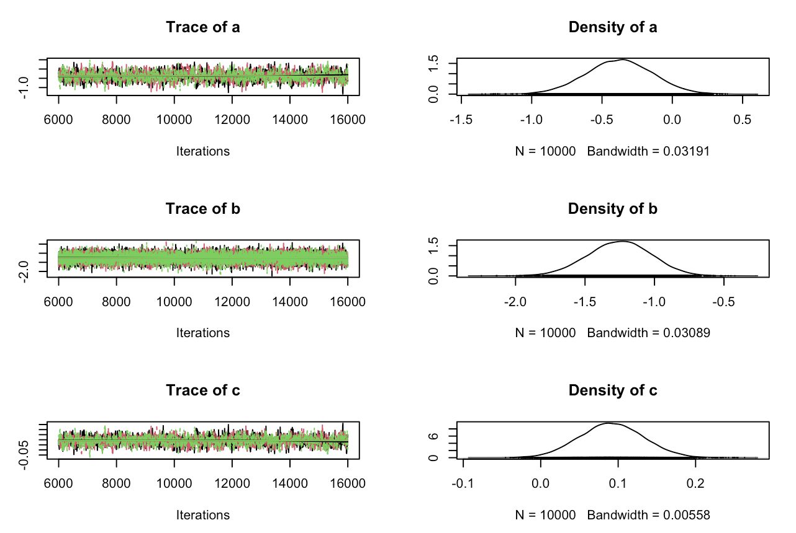
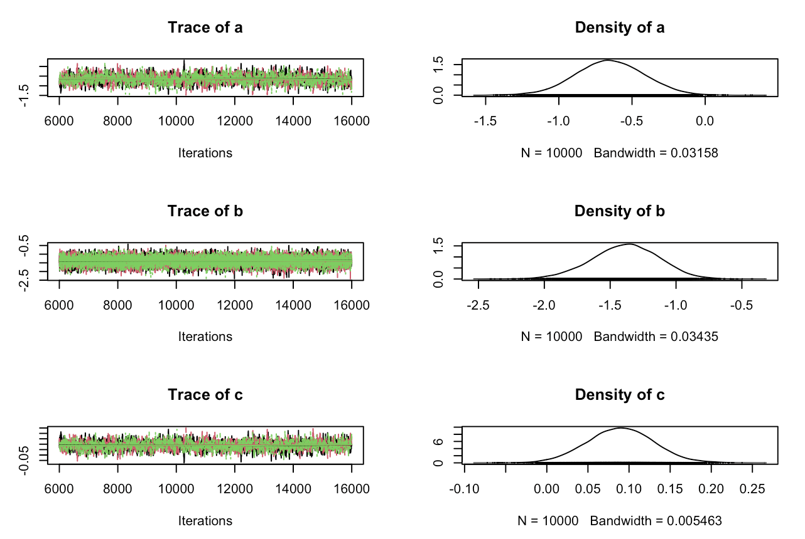
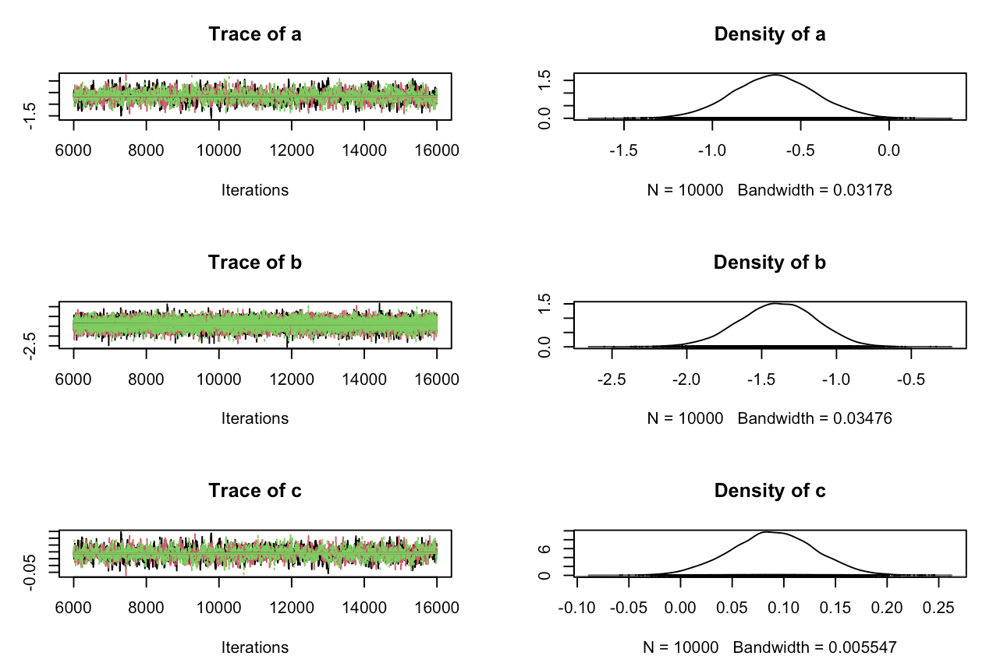

## 1. Préparation des données

Le fichier est importé avec `read.table()`, puis les dix colonnes sont nommées. La variable `infecte` regroupe les statuts d’infection en deux catégories : **0 = non infecté ; 1 = infecté**, avec ou sans symptômes.

Nous conservons uniquement les contacts (`index_contact == 0`) et excluons les personnes ayant une infection antérieure (`statut_vaccinal == -1`). L’objectif est d’étudier l’infection chez les contacts selon leur vaccination et la taille de leur foyer.

Parmi les 687 contacts, 20 sont exclus pour infection antérieure. L’analyse porte donc sur **667 contacts, dont 269 infectés**.

| Statut vaccinal | Non infectés | Infectés | Total | Proportion infectée |
|---|---:|---:|---:|---:|
| Non-vaccinés selon la définition de l’étude | 294 | 248 | 542 | 45,8 % |
| Vaccinés selon la définition de l’étude | 104 | 21 | 125 | 16,8 % |

La proportion d’infectés est plus faible chez les vaccinés. Cette comparaison est descriptive : elle ne tient pas encore compte de la taille du foyer.

Enfin, `data_jags` rassemble les informations nécessaires au modèle : le nombre de contacts (`N`), leur infection (`infecte`), leur statut vaccinal (`vacc`) et la taille de leur foyer (`taille_foyer`).

## 2. Définition du modèle et initialisation

Nous définissons une régression logistique bayésienne pour étudier l’association entre vaccination et infection, en tenant compte de la taille du foyer.

Pour chaque contact `i`, l’infection suit une loi de Bernoulli de probabilité `p[i]`, avec :

logit(p[i]) = a + b × vacc[i] + c × taille_foyer[i]

- `a` : constante sur l’échelle logit.
- `b` : association avec la vaccination, à taille de foyer identique.
- `c` : association avec la taille du foyer, à statut vaccinal identique.

Le modèle suppose les infections indépendantes conditionnellement aux coefficients et aux variables explicatives. Il ne contient pas d’effet propre à chaque foyer.

Les trois coefficients reçoivent un prior `dnorm(0, 0.16)`. Dans JAGS, le deuxième argument est la précision : ces priors ont donc une moyenne de **0** et un écart-type de **2,5**.

Les bibliothèques `rjags` et `coda` sont chargées pour réaliser l’estimation et examiner les chaînes MCMC. Trois jeux de valeurs initiales différents sont préparés pour les trois chaînes.

À ce stade, le modèle est défini, mais aucune estimation n’a encore été réalisée. Les valeurs initiales ne sont pas des résultats.

## 3. Création des données simulées

Pour tester la procédure d’estimation, nous générons des infections fictives avec des coefficients connus : **a = −0,5 ; b = −1 ; c = 0,1**.

Nous conservons les statuts vaccinaux et les tailles de foyer des 667 contacts. La fonction `plogis()` calcule leurs probabilités d’infection à partir des coefficients choisis, puis `rbinom(size = 1)` génère un résultat **0 ou 1** pour chaque contact.

`set.seed(123)` rend cette simulation reproductible avec les mêmes données.

| Statut simulé | Nombre de contacts |
|---|---:|
| Non infecté | 352 |
| Infecté | 315 |
| **Total** | **667** |

Les vraies infections restent inchangées. Le bloc suivant utilisera ces données simulées pour vérifier si le modèle retrouve les coefficients qui les ont générées.

## 4. Estimation sur les données simulées

Nous ajustons le modèle aux infections simulées pour vérifier s’il retrouve les coefficients utilisés pour les générer. Les valeurs connues de ces coefficients ne sont pas transmises à JAGS.

Trois chaînes sont lancées avec 1000 itérations d’adaptation, puis 5000 itérations de burn-in. Nous conservons ensuite **10000 tirages par chaîne**, soit 30000 tirages au total.

### Diagnostics des chaînes

Les trois chaînes se superposent sans dérive visible. Les diagnostics de Gelman-Rubin sont affichés à 1 pour les trois coefficients. Les tailles effectives sont d’environ **1179 pour a**, **13304 pour b** et **1 182 pour c**. Ces éléments sont compatibles avec une bonne convergence.

### Comparaison aux coefficients connus

| Coefficient | Valeur utilisée pour simuler | Moyenne estimée | Intervalle de crédibilité à 95 % |
|---|---:|---:|---|
| a | −0,5 | −0,378 | [−0,844 ; 0,084] |
| b | −1 | −1,253 | [−1,710 ; −0,813] |
| c | 0,1 | 0,092 | [0,011 ; 0,173] |

Les trois valeurs connues sont comprises dans leurs intervalles de crédibilité. Les écarts entre valeurs choisies et estimées sont compatibles avec la variabilité des données simulées.

Ce test est rassurant pour le fonctionnement de la procédure d’estimation. Une seule simulation ne constitue toutefois pas une validation exhaustive et ne garantit pas que le modèle représente correctement les données réelles.

## 5. Estimation sur les données réelles

Nous ajustons le modèle aux infections observées chez les **667 contacts**, afin d’étudier les associations avec la vaccination et la taille du foyer.

Les réglages restent identiques : trois chaînes, 1000 itérations d’adaptation, 5000 de burn-in et 10000 tirages conservés par chaîne. Les priors sont `dnorm(0, 0.16)`.

### Diagnostics des chaînes

Les chaînes se superposent sans dérive visible. Les diagnostics de Gelman-Rubin sont affichés à 1. Les tailles effectives sont d’environ **1233 pour a**, **15082 pour b** et **1297 pour c**. Ces résultats sont compatibles avec une bonne convergence.

### Estimations et interprétation

| Coefficient | Moyenne estimée | Intervalle de crédibilité à 95 % |
|---|---:|---|
| a — constante | −0,651 | [−1,112 ; −0,195] |
| b — vaccination | −1,386 | [−1,905 ; −0,905] |
| c — taille du foyer | 0,090 | [0,010 ; 0,170] |

- **Vaccination :** à taille de foyer identique, elle est associée à une probabilité d’infection plus faible. Tous les tirages conservés de `b` sont négatifs : la probabilité a posteriori estimée de `b < 0` est proche de 1, sans signifier une certitude absolue.
- **Taille du foyer :** à statut vaccinal identique, une taille plus élevée est associée à une probabilité d’infection plus grande. La probabilité a posteriori estimée de `c > 0` est de **98,7 %**.
- **Constante :** `a` correspond au logit de la probabilité pour un contact non vacciné dans un foyer de taille zéro ; elle n’a donc pas d’interprétation pratique directe.

Ces coefficients sont exprimés sur l’échelle logit, et non en pourcentages. Les associations sont estimées sous les hypothèses du modèle, sans ajustement sur l’âge ou l’isolement, et ne suffisent pas à établir un effet causal. La capacité du modèle à reproduire les observations sera examinée par les vérifications prédictives.

## 6. Sensibilité au choix des priors

Nous ajustons le même modèle aux mêmes données, en élargissant les priors de `a`, `b` et `c`. L’objectif est de vérifier si les résultats dépendent fortement de ce choix.

Dans JAGS, le deuxième argument de `dnorm` est la précision :

- Prior initial : `dnorm(0, 0.16)`, soit un écart-type de 2,5.
- Prior élargi : `dnorm(0, 0.01)`, soit un écart-type de 10.

Nous conservons les mêmes réglages : trois chaînes, 1000 itérations d’adaptation, 5000 de chauffe et 10000 tirages conservés par chaîne.

### Diagnostics des chaînes

Les chaînes se superposent sans dérive visible. Les indicateurs de Gelman-Rubin sont affichés à 1 et les tailles effectives sont d’environ 1 282 pour `a`, 14 375 pour `b` et 1 319 pour `c`. Ces diagnostics sont rassurants pour la convergence.

### Comparaison des résultats

| Coefficient | Moyenne, prior initial | Moyenne, prior élargi | Intervalle crédible à 95 % avec le prior élargi |
|---|---:|---:|---|
| `a` : constante | −0,651 | −0,649 | [−1,113 ; −0,181] |
| `b` : vaccination | −1,386 | −1,396 | [−1,917 ; −0,910] |
| `c` : taille du foyer | 0,090 | 0,090 | [0,008 ; 0,170] |

Les estimations et les intervalles crédibles restent très proches de ceux obtenus avec les priors initiaux.

À taille de foyer identique, la vaccination reste associée à une probabilité d’infection plus faible. À statut vaccinal identique, une taille de foyer plus élevée reste associée à une probabilité d’infection plus élevée.

Les conclusions sont donc peu sensibles à cet élargissement des priors. Nous conservons les tirages du modèle avec les priors initiaux pour la suite.

## 7. Probabilités d’infection par profil

Nous utilisons les tirages a posteriori du modèle avec les priors initiaux pour estimer la probabilité d’infection selon le statut vaccinal et la taille du foyer.

Pour chaque profil, nous calculons une probabilité à chaque tirage des coefficients, puis sa moyenne et son intervalle crédible à 95 %. L’effectif indique le nombre de contacts de ce profil présents dans les données.

### Résultats pour quelques profils

| Taille du foyer | Statut vaccinal | Probabilité moyenne | Intervalle crédible à 95 % | Effectif |
|---|---|---:|---|---:|
| 2 | Non vacciné | 38,5 % | [31,2 % ; 46,1 %] | 24 |
| 2 | Vacciné | 13,8 % | [8,4 % ; 20,5 %] | 8 |
| 4 | Non vacciné | 42,8 % | [37,9 % ; 47,7 %] | 95 |
| 4 | Vacciné | 16,0 % | [10,2 % ; 22,7 %] | 45 |
| 8 | Non vacciné | 51,7 % | [44,9 % ; 58,4 %] | 55 |
| 8 | Vacciné | 21,4 % | [13,4 % ; 31,0 %] | 8 |
| 12 | Non vacciné | 60,3 % | [46,8 % ; 72,9 %] | 20 |
| 12 | Vacciné | 28,3 % | [15,4 % ; 44,4 %] | 0 |

À taille de foyer identique, le modèle estime une probabilité d’infection plus faible chez les vaccinés. Par exemple, pour un foyer de quatre personnes, elle est de 16,0 % contre 42,8 % chez les non-vaccinés.

Les probabilités moyennes augmentent avec la taille du foyer dans les deux groupes.

Le profil « vacciné dans un foyer de 12 personnes » n’est pas représenté dans les données : son estimation repose sur une extrapolation du modèle.

Ces intervalles décrivent l’incertitude sur les probabilités estimées. Ce bloc facilite l’interprétation du modèle ; la comparaison entre observations et infections simulées est réalisée à l’étape suivante.

## 8. Vérification prédictive par statut vaccinal

L’objectif est de vérifier si le modèle reproduit les proportions d’infection observées chez les vaccinés et les non-vaccinés.

Nous sélectionnons 2000 tirages a posteriori. Pour chacun, nous calculons les probabilités d’infection des 667 contacts, puis simulons leur statut d’infection en conservant leurs caractéristiques réelles. Nous calculons ensuite la proportion d’infectés dans chaque groupe.

### Résultats

| Groupe | Proportion observée | Moyenne simulée | Intervalle prédictif à 95 % |
|---|---:|---:|---|
| Non-vaccinés | 45,8 % | 45,8 % | [40,2 % ; 51,5 %] |
| Vaccinés | 16,8 % | 17,1 % | [8,8 % ; 26,4 %] |

Les proportions observées sont proches des moyennes simulées et se trouvent dans les intervalles prédictifs à 95 %. Le modèle reproduit donc correctement les proportions globales d’infection dans ces deux groupes.

Ces intervalles prennent en compte l’incertitude sur les coefficients et la variabilité des infections simulées.

Cette vérification porte sur les données ayant servi à ajuster le modèle. Elle ne garantit pas que celui-ci reproduise aussi la répartition des infections entre foyers, examinée à l’étape suivante.

## 9. Vérification prédictive par foyer

Nous vérifions si le modèle reproduit la répartition des infections entre foyers. Pour chacune des 2000 simulations, nous comptons les foyers où aucun contact n’est infecté et ceux où tous les contacts sont infectés.

Ces comptages concernent uniquement les contacts retenus dans l’analyse, sans les cas index ni les personnes ayant une infection antérieure.

### Résultats

| Situation | Nombre de foyers observé | Moyenne simulée | Intervalle prédictif à 95 % |
|---|---:|---:|---|
| Aucun contact infecté | 97 | 62,8 | [49 ; 78] |
| Tous les contacts infectés | 43 | 22,2 | [13 ; 32] |

Dans les deux cas, le nombre observé dépasse la borne supérieure de l’intervalle prédictif. Le modèle sous-estime donc les foyers où aucun contact n’est infecté et ceux où tous les contacts sont infectés.

Même s’il reproduit les proportions globales par statut vaccinal, il ne restitue pas correctement cette répartition entre foyers.

### Limite mise en évidence

Le modèle suppose les infections indépendantes une fois pris en compte le statut vaccinal, la taille du foyer et les coefficients. Il ne représente pas explicitement l’exposition commune des contacts d’un même foyer.

Les écarts observés suggèrent une hétérogénéité entre foyers ou une dépendance entre leurs membres insuffisamment prise en compte. L’ajout de l’isolement pourra être évalué avec les mêmes vérifications ; un effet aléatoire de foyer constitue également une piste d’amélioration.

Les associations estimées avec la vaccination et la taille du foyer doivent donc être interprétées en tenant compte de cette limite.