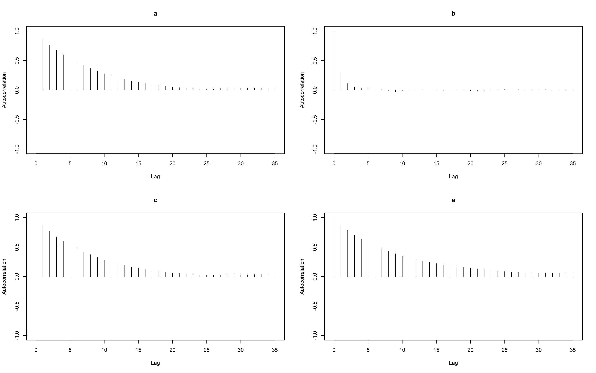
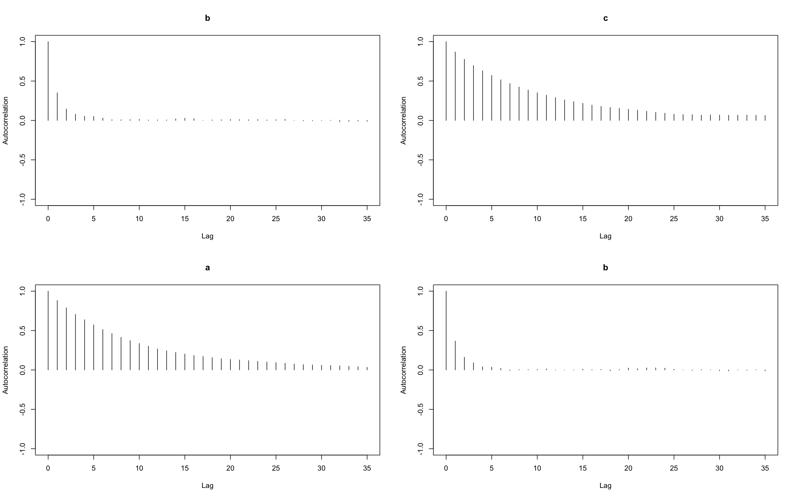
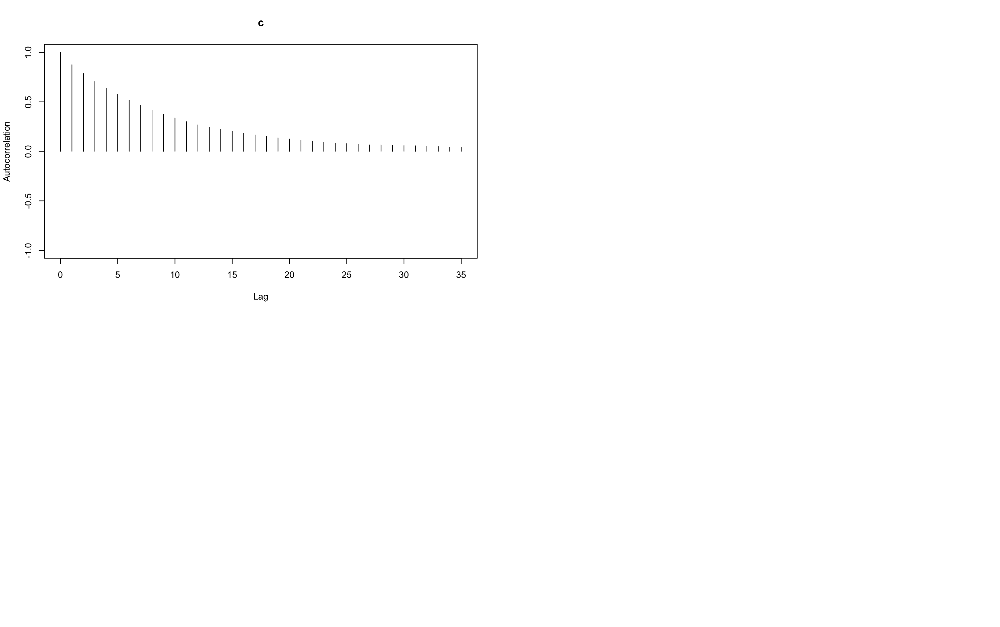
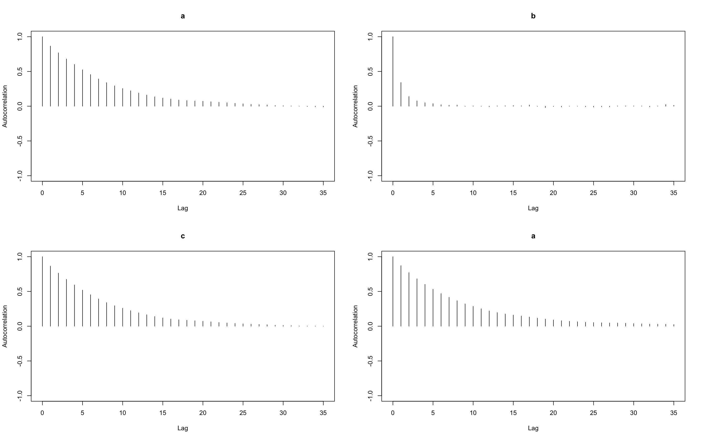
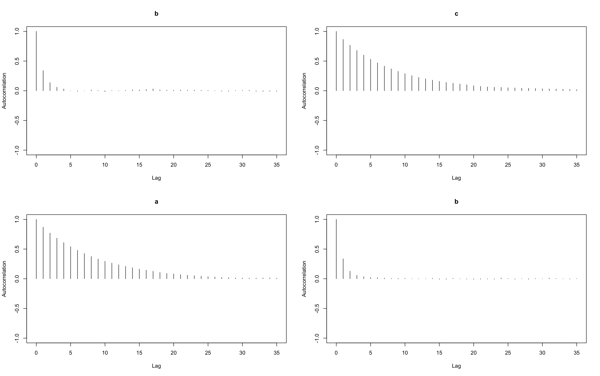
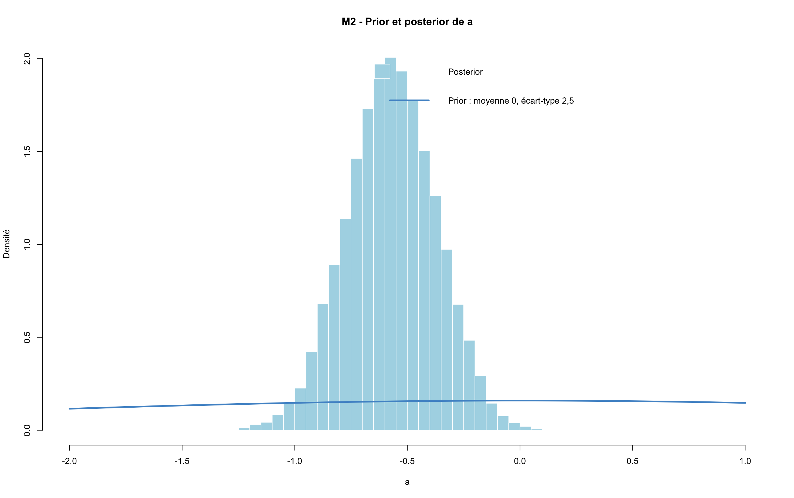
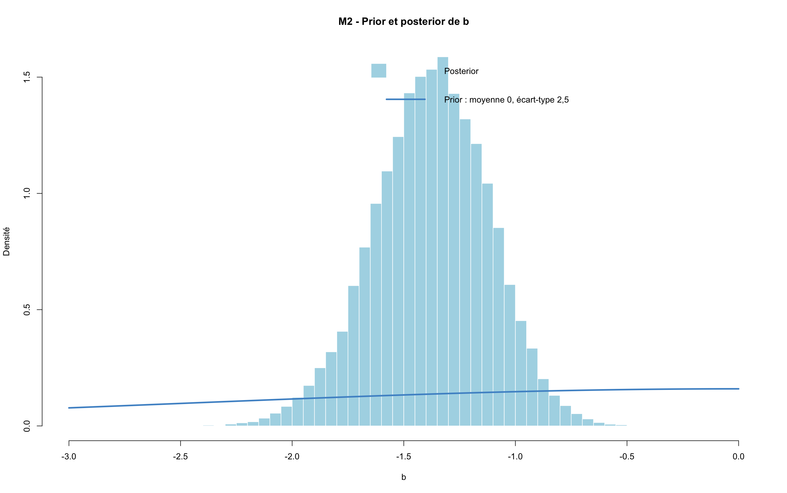
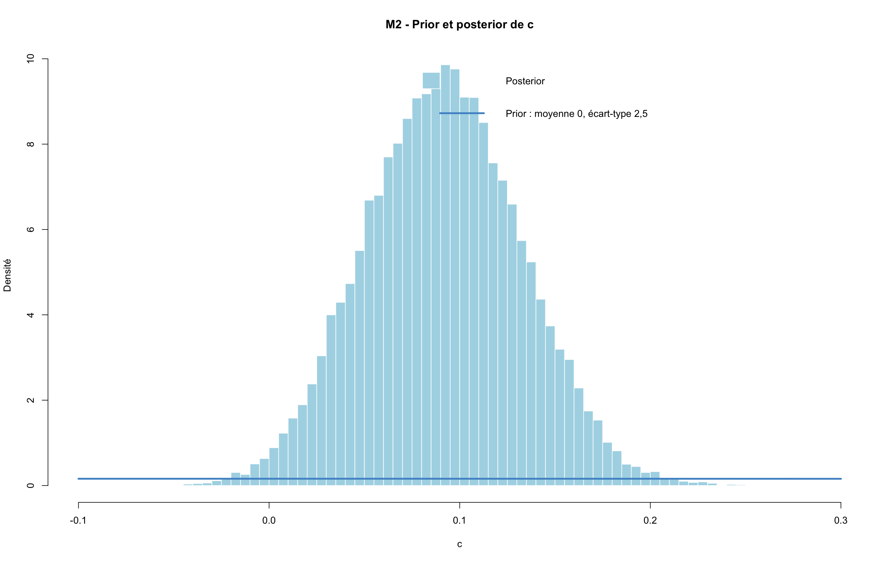

## 1. Préparation des données

Le fichier est importé avec `read.table()`, puis les dix colonnes sont nommées. La variable `infecte` regroupe les statuts d’infection en deux catégories : **0 = non infecté ; 1 = infecté**, avec ou sans symptômes.

Nous conservons uniquement les contacts (`index_contact == 0`) et excluons les personnes ayant une infection durant l’année précédente (`statut_vaccinal == -1`). 

L’objectif est d’étudier l’infection chez les contacts selon leur vaccination et la taille de leur foyer.

Parmi les 687 contacts, 20 sont exclus pour infection antérieure. L’analyse porte donc sur **667 contacts, dont 269 infectés**.

| Statut vaccinal | Non infectés | Infectés | Total | Proportion infectée |
|---|---:|---:|---:|---:|
| Non-vaccinés | 294 | 248 | 542 | 45,8 % |
| Vaccinés | 104 | 21 | 125 | 16,8 % |

La proportion d’infectés est plus faible chez les vaccinés. Cette comparaison est descriptive : elle ne tient pas encore compte de la taille du foyer.

Enfin, `data_jags` rassemble les informations nécessaires au modèle : le nombre de contacts (`N`), leur infection (`infecte`), leur statut vaccinal (`vacc`) et la taille de leur foyer (`taille_foyer`).

## 2. Définition du modèle et initialisation

Nous cherchons à estimer la probabilité d’infection d’un contact en prenant en compte son statut vaccinal et la taille de son foyer.

Pour chaque contact `i`, l’infection suit une loi de Bernoulli de probabilité `p[i]`, avec :

logit(p[i]) = a + b × vacc[i] + c × (taille_foyer[i]-1)

- `a` : constante sur l’échelle logit.
- `b` : association avec la vaccination, à taille de foyer identique.
- `c` : association avec la taille du foyer, à statut vaccinal identique.

Le modèle suppose les infections indépendantes conditionnellement aux coefficients et aux variables explicatives. Il ne contient pas d’effet propre à chaque foyer.

Les trois coefficients reçoivent un prior `dnorm(0, 0.16)`. Dans JAGS, le deuxième argument est la précision : ces priors ont donc une moyenne de **0** et un écart-type de **2,5**.

Les bibliothèques `rjags` et `coda` sont chargées pour réaliser l’estimation et examiner les chaînes MCMC. Trois jeux de valeurs initiales différents sont préparés pour les trois chaînes.

## 3. Création des données simulées

Pour tester la procédure d’estimation, nous générons des infections fictives avec des coefficients connus : **a = −0,5 ; b = −1 ; c = 0,1**.

Nous conservons les statuts vaccinaux et les tailles de foyer des 667 contacts. La fonction `plogis()` calcule leurs probabilités d’infection à partir des coefficients choisis, puis `rbinom(size = 1)` génère un résultat **0 ou 1** pour chaque contact.

`set.seed(123)` rend cette simulation reproductible avec les mêmes données.

| Statut simulé | Nombre de contacts |
|---|---:|
| Non infecté | 371 |
| Infecté | 296 |
| **Total** | **667** |

Les vraies infections restent inchangées. Le bloc suivant utilisera ces données simulées pour vérifier si le modèle retrouve les coefficients qui les ont générées.

## 4. Estimation sur les données simulées

Nous ajustons le modèle aux infections simulées pour vérifier s’il retrouve des coefficients compatibles avec ceux utilisés pour les générer. Les valeurs connues de ces coefficients ne sont pas transmises à JAGS.

Trois chaînes sont lancées avec 1000 itérations d’adaptation, puis 5000 itérations de burn-in, écartées pour réduire l’influence des points de départ. Nous conservons ensuite **10000 tirages par chaîne**, soit 30000 tirages au total.

### Diagnostics des chaînes

À gauche, les tracés représentent l’évolution des coefficients au fil des itérations. Les trois chaînes se superposent sans dérive visible. À droite, les courbes représentent les distributions a posteriori des coefficients.

Les diagnostics de Gelman–Rubin sont arrondis à **1** pour les trois coefficients. Les tailles effectives sont d’environ **1714 pour a**, **13077 pour b** et **1736 pour c**. Elles tiennent compte de la dépendance entre les tirages : les 30 000 tirages conservés ne sont pas tous indépendants. Ces éléments sont compatibles avec une bonne convergence.

Les graphiques suivants montrent l’autocorrélation des trois paramètres dans chacune des trois chaînes.

L’axe « Lag » représente le nombre d’itérations séparant les tirages comparés. L’autocorrélation diminue rapidement vers zéro pour `b`, mais plus lentement pour `a` et `c`. Cela explique leurs tailles effectives plus faibles.

### Comparaison aux coefficients connus

| Coefficient | Valeur utilisée pour simuler | Moyenne estimée | Intervalle de crédibilité à 95 % |
|---|---:|---:|---|
| a | −0,5 | −0,382 | [−0,770 ; 0,009] |
| b | −1 | −1,227 | [−1,696 ; −0,779] |
| c | 0,1 | 0,084 | [0,004 ; 0,165] |

Les trois valeurs connues sont comprises dans leurs intervalles de crédibilité. Les écarts entre valeurs choisies et estimées sont compatibles avec la variabilité des données simulées.

Ce test est rassurant pour le fonctionnement de la procédure d’estimation. Une seule simulation ne constitue toutefois pas une validation exhaustive et ne garantit pas que le modèle représente correctement les données réelles.

## 5. Estimation sur les données réelles

Nous ajustons le modèle aux infections observées chez les 667 contacts, afin d’étudier les associations avec la vaccination et la taille du foyer.

### Diagnostics des chaînes

Les chaînes se superposent sans dérive visible. Les diagnostics de Gelman–Rubin sont arrondis à **1**. Les tailles effectives sont d’environ **1894 pour a**, **13793 pour b** et **1877 pour c**. Ces résultats sont compatibles avec une bonne convergence.

L’autocorrélation diminue rapidement vers zéro pour `b`, mais plus lentement pour `a` et `c`. Les tirages successifs de ces deux paramètres restent donc davantage dépendants, ce qui explique leurs tailles effectives plus faibles.

### Estimations et interprétation

| Coefficient | Moyenne estimée | Intervalle de crédibilité à 95 % |
|---|---:|---|
| a — constante | −0,571 | [−0,957 ; −0,189] |
| b — vaccination | −1,377 | [−1,904 ; −0,894] |
| c — taille du foyer | 0,091 | [0,012 ; 0,172] |

- **Vaccination :** à taille de foyer identique, elle est associée à une probabilité d’infection plus faible. Tous les tirages conservés de `b` sont négatifs : la probabilité a posteriori estimée de `b < 0` est proche de 1, sans signifier une certitude absolue.

- **Taille du foyer :** à statut vaccinal identique, une taille plus élevée est associée à une probabilité d’infection plus grande. La probabilité a posteriori estimée de `c > 0` est de **98,92 %**.

- **Constante :**  `a` correspond au logit de la probabilité pour un contact non vacciné dans un foyer d’une personne. Cette référence reste théorique, car les foyers analysés comptent au moins deux personnes.

Ces coefficients sont exprimés sur l’échelle logit, et non en pourcentages. Par exemple, `c = 0,091` ne signifie pas une augmentation de 9,1 points de pourcentage par personne supplémentaire.

Les associations sont estimées sous les hypothèses du modèle, sans ajustement sur l’âge ou l’isolement, et ne suffisent pas à établir un effet causal.

Les diagnostics des chaînes évaluent le fonctionnement de l’estimation. La capacité du modèle à reproduire les observations sera examinée ensuite par les vérifications prédictives.

## 6. Comparaison entre prior et posterior

Nous comparons, pour chaque coefficient, la distribution choisie avant l’analyse (**prior**, courbe bleue) à celle obtenue après prise en compte des données (**posterior**, histogramme bleu clair).

Les trois priors sont des lois normales de moyenne 0 et d’écart-type 2,5.

Les distributions a posteriori sont beaucoup plus concentrées que les priors : les données ont réduit l’incertitude sur les coefficients.

Le posterior de `b` se concentre sur des valeurs négatives, tandis que celui de `c` se situe principalement sur des valeurs positives. Cela rejoint les résultats précédents concernant la vaccination et la taille du foyer.

## 7. Corrélations a posteriori entre paramètres

Nous utilisons `crosscorr(tirages)` pour examiner comment les coefficients varient ensemble dans les tirages a posteriori.

Une corrélation proche de 1 indique qu’ils tendent à augmenter ensemble,  proche de −1, qu’ils évoluent en sens opposés, proche de 0, qu’ils présentent peu de liaison linéaire.

| Paramètres | Corrélation |
|---|---:|
| a et b | −0,22 |
| a et c | −0,90 |
| b et c | 0,08 |

La constante `a` et le coefficient de taille du foyer `c` présentent une forte corrélation négative. Une augmentation de `c` peut être partiellement compensée par une diminution de `a`, tout en conservant des probabilités d’infection similaires pour les profils observés.

Le coefficient de vaccination `b` présente une faible corrélation avec `a` et une corrélation presque nulle avec `c`.

## 8. Sensibilité au choix des priors

Nous ajustons le même modèle aux mêmes données, en élargissant les priors de `a`, `b` et `c`. L’objectif est de vérifier si les résultats dépendent fortement de ce choix.

Dans JAGS, le deuxième argument de `dnorm` est la précision :

- Prior initial : `dnorm(0, 0.16)`, soit un écart-type de 2,5.
- Prior élargi : `dnorm(0, 0.01)`, soit un écart-type de 10.

Nous conservons les mêmes réglages : trois chaînes, 1000 itérations d’adaptation, 5000 de chauffe et 10000 tirages conservés par chaîne.

### Diagnostics des chaînes

Les indicateurs de Gelman–Rubin sont arrondis à **1** et les tailles effectives sont d’environ **1736 pour `a`**, **14255 pour `b`** et **1811 pour `c`**. Ces diagnostics numériques sont rassurants pour la convergence.

### Comparaison des résultats

| Coefficient | Moyenne, prior initial | Moyenne, prior élargi | Intervalle crédible à 95 % avec le prior élargi |
|---|---:|---:|---|
| `a` : constante | −0,571 | −0,567 | [−0,957 ; −0,177] |
| `b` : vaccination | −1,377 | −1,393 | [−1,919 ; −0,902] |
| `c` : taille du foyer | 0,091 | 0,091 | [0,011 ; 0,172] |

Les estimations et les intervalles crédibles restent très proches de ceux obtenus avec les priors initiaux.

À taille de foyer identique, la vaccination reste associée à une probabilité d’infection plus faible. À statut vaccinal identique, une taille de foyer plus élevée reste associée à une probabilité d’infection plus élevée.

Les conclusions sont donc peu sensibles à cet élargissement des priors, dont l’écart-type passe de **2,5 à 10**. Nous conservons les tirages du modèle avec les priors initiaux pour la suite.

## 9. Probabilités d’infection par profil

Nous utilisons les tirages a posteriori du modèle avec les priors initiaux pour répondre à une question concrète : **quelle probabilité d’infection le modèle estime-t-il pour un contact, selon sa vaccination et la taille de son foyer ?**

Un profil correspond à une combinaison de ces deux caractéristiques, par exemple « contact vacciné vivant dans un foyer de quatre personnes ».

Pour chaque profil, chaque tirage des coefficients donne une probabilité d’infection. Nous résumons ces probabilités par leur moyenne et leur intervalle crédible à 95 %. L’effectif indique combien de contacts correspondent à ce profil dans les données.

### Résultats pour quelques profils

| Taille du foyer | Statut vaccinal | Probabilité moyenne | Intervalle crédible à 95 % | Effectif |
|---|---|---:|---|---:|
| 2 | Non vacciné | 38,3 % | [31,1 % ; 45,9 %] | 24 |
| 2 | Vacciné | 13,8 % | [8,3 % ; 20,6 %] | 8 |
| 4 | Non vacciné | 42,7 % | [37,8 % ; 47,6 %] | 95 |
| 4 | Vacciné | 16,1 % | [10,2 % ; 22,9 %] | 45 |
| 8 | Non vacciné | 51,7 % | [45,0 % ; 58,5 %] | 55 |
| 8 | Vacciné | 21,6 % | [13,5 % ; 31,3 %] | 8 |
| 12 | Non vacciné | 60,5 % | [47,1 % ; 73,2 %] | 20 |
| 12 | Vacciné | 28,7 % | [15,5 % ; 44,9 %] | 0 |

### Interprétation

À taille de foyer identique, le modèle estime une probabilité d’infection plus faible chez les vaccinés. Par exemple, dans un foyer de quatre personnes, elle est de **16,1 % pour un contact vacciné**, contre **42,7 % pour un contact non vacciné**.

Les probabilités moyennes augmentent avec la taille du foyer dans les deux groupes. Ces résultats traduisent les coefficients du modèle en probabilités, plus faciles à interpréter.

Les intervalles crédibles indiquent l’incertitude sur ces probabilités. Par exemple, pour un contact vacciné dans un foyer de quatre personnes, l’intervalle est de **[10,2 % ; 22,9 %]**, autour d’une moyenne de 16,1 %.

Le profil « vacciné dans un foyer de 12 personnes » ne correspond à aucun contact observé. Le modèle peut néanmoins calculer une probabilité pour ce profil : il s’agit d’une extrapolation, à interpréter avec prudence.

Ces valeurs sont des **estimations du modèle**, et non les proportions directement observées dans chaque profil. Elles décrivent des associations et ne suffisent pas à établir un effet causal de la vaccination.

La comparaison entre les observations et les infections simulées à partir du modèle sera réalisée à l’étape suivante.

## 10. Vérification prédictive par statut vaccinal

Nous vérifions si le modèle peut générer des données ressemblant aux observations, concernant la proportion d’infectés chez les vaccinés et les non-vaccinés.

### Démarche

Nous créons **2000 versions fictives de notre échantillon de 667 contacts**. Dans chaque version :

1. Nous choisissons un tirage des coefficients estimés à partir des données réelles.
2. Nous calculons la probabilité d’infection de chaque contact, en conservant sa vaccination et la taille de son foyer.
3. Nous tirons au hasard son statut d’infection, selon cette probabilité.
4. Nous calculons la proportion d’infectés chez les vaccinés et les non-vaccinés.

Nous comparons ensuite ces proportions simulées aux proportions réellement observées.

### Résultats

| Groupe | Proportion observée | Moyenne simulée | Intervalle prédictif à 95 % |
|---|---:|---:|---|
| Non-vaccinés | 45,8 % | 45,7 % | [40,0 % ; 51,7 %] |
| Vaccinés | 16,8 % | 17,1 % | [8,8 % ; 27,2 %] |

L’intervalle prédictif contient les 95 % centraux des proportions simulées. Il tient compte de l’incertitude sur les coefficients et du hasard dans les infections générées.

### Interprétation

Les proportions observées sont proches des moyennes simulées et se trouvent dans les intervalles prédictifs. **Le modèle reproduit donc bien les proportions globales d’infection dans ces deux groupes.**

## 11. Vérification prédictive par foyer

Le modèle peut retrouver le bon nombre total d’infectés sans reproduire leur répartition entre les foyers. Nous vérifions donc ces deux aspects.

### Démarche

Nous simulons 2000 versions des infections des 667 contacts, à partir des coefficients a posteriori. Nous conservons leurs caractéristiques et leur appartenance aux foyers.

Pour chaque simulation, nous comptons les infectés dans chaque foyer, puis calculons :

- Le nombre total d’infectés.
- Le nombre de foyers sans contact infecté.
- Le nombre de foyers où tous les contacts analysés sont infectés.
- L’écart-type du nombre d’infectés par foyer : il mesure à quel point ces nombres diffèrent entre les foyers.

Les cas index et les personnes ayant une infection antérieure restent exclus de ces calculs.

### Résultats

| Caractéristique | Valeur observée | Moyenne simulée | Intervalle prédictif à 95 % |
|---|---:|---:|---|
| Total d’infectés | 269 | 269,4 | [235 ; 303] |
| Foyers sans contact infecté | 97 | 62,9 | [49 ; 78] |
| Foyers avec tous les contacts analysés infectés | 43 | 22,1 | [13 ; 32] |
| Écart-type du nombre d’infectés par foyer | 1,62 | 1,27 | [1,11 ; 1,46] |

Les intervalles prédictifs contiennent les 95 % centraux des valeurs simulées.

### Interprétation

Le modèle reproduit bien le total d’infectés : 269 observés contre 269,4 en moyenne dans les simulations.

En revanche, il produit trop peu de foyers sans infection et de foyers où tous les contacts analysés sont infectés. Les nombres observés, respectivement **97 et 43**, dépassent les bornes supérieures des intervalles prédictifs.

Le modèle retrouve donc le total, mais répartit les infections de manière trop uniforme entre les foyers. L’écart-type observé, plus élevé que celui généralement simulé, confirme qu’il sous-estime les différences entre foyers.

### Conclusion

**Le modèle 2 reproduit les proportions globales d’infection, mais représente mal leur répartition entre les foyers.**

Il ne tient compte que de la vaccination et de la taille du foyer. Des facteurs absents du modèle, comme l’isolement ou une exposition commune aux membres d’un foyer, pourraient contribuer à ces écarts. Cette vérification ne permet pas d’en identifier la cause à elle seule.

La comparaison avec le modèle 3 permettra d’examiner si l’ajout de l’isolement améliore ces résultats.