# Modèle final : vaccination, taille du foyer et isolement

**Problématique : dans quelle mesure la vaccination, la taille du foyer et l'isolement sont-ils associés au risque d'infection des contacts ?**

## 1. Préparation des données

Nous utilisons le fichier `2021_05_14_full_database_2doses.txt`, issu de l'article de Layan et al. (2022), car c'est le plus complet et le plus propre. Il décrit, pour chaque individu, son foyer, la taille du foyer, son statut d'infection, son statut vaccinal, son statut de cas index et son niveau d'isolement.

Trois choix de préparation :

- **Variable réponse binaire.** Les statuts « infecté » (1, 2, 3) sont regroupés en une seule modalité (**1**), les non-infectés restant à **0**. On obtient ainsi une variable binaire, nécessaire à une loi de Bernoulli.
- **Contacts uniquement.** Les cas index sont exclus : ils sont infectés par définition, les garder fausserait l'estimation du risque.
- **Exclusion des infections antérieures.** Les 20 contacts déjà infectés avant l'étude sont retirés : leur protection ne vient pas du vaccin et l'article ne les considère pas comme susceptibles.

On obtient **667 contacts, dont 269 infectés (40 %)**, soit l'échantillon de l'article.

| Variable | Codage | Rôle |
|---|---|---|
| `vaccinated` | 0 = non vacciné ; 1 = vacciné | Protection vaccinale |
| `household_size` | nombre de personnes (2 à 12) | Exposition dans le foyer |
| `isolated` | 0 = aucun ; 1 = partiel ; 2 = complet | Séparation avec le cas index |

**Isolement non regroupé.** L'article fusionne isolement partiel et complet. Nous les gardons séparés pour tester s'ils ont des effets différents.

**Taille du foyer centrée.** On utilise `household_size − 2` pour que la constante du modèle ait un sens concret : elle correspond au plus petit foyer observé (2 personnes).

## 2. Définition du modèle

Nous utilisons une **régression logistique bayésienne**. Pour chaque contact `i`, l'infection suit une loi de Bernoulli de probabilité `p[i]` :

logit(p[i]) = a + b_vacc × vaccinated[i] + c_size × (household_size[i] − 2) + d_iso × (isolated[i] = 1) + e_iso × (isolated[i] = 2)

| Coefficient | Signification | Interprétation |
|---|---|---|
| `a` | Constante | Logit du risque d'un contact non vacciné, non isolé, dans un foyer de 2 personnes |
| `b_vacc` | Effet de la vaccination | exp(b_vacc) = odds ratio vacciné vs non vacciné |
| `c_size` | Effet d'une personne de plus dans le foyer | exp(c_size) = odds ratio par personne supplémentaire |
| `d_iso` | Isolement partiel vs aucun isolement | exp(d_iso) = odds ratio |
| `e_iso` | Isolement complet vs aucun isolement | exp(e_iso) = odds ratio |

Le niveau « aucun isolement » sert de référence. Les coefficients sont sur l'échelle logit ; on les lit en **odds ratios** (exp du coefficient). Un coefficient négatif signifie un risque plus faible.

## 3. Initialisation et échantillonnage MCMC

**Valeurs initiales.** Les trois chaînes MCMC démarrent de points volontairement éloignés les uns des autres (par exemple `a` = −2, 0 et 2). Si elles finissent par se superposer malgré ces départs dispersés, c'est un argument solide de convergence. Partir de points proches pourrait donner une fausse impression de convergence.

**Échantillonnage.**

| Étape | Réglage | Rôle |
|---|---|---|
| Chaînes | 3 | Comparer les chaînes entre elles pour vérifier la convergence |
| Burn-in | 2000 itérations | Écarter le début des chaînes, encore influencé par les valeurs initiales |
| Tirages conservés | 10 000 par chaîne | **30 000 tirages a posteriori** au total |

Ces tirages servent à tout le reste de l'analyse (estimations, intervalles crédibles, probabilités prédites, vérifications prédictives).

## 4. Diagnostics de convergence

Avant d'interpréter quoi que ce soit, on vérifie que les chaînes ont bien exploré la distribution a posteriori.

### Traces et distributions

Pour les cinq coefficients, les trois chaînes se superposent, sans dérive ni tendance : elles fluctuent autour d'une valeur stable. Les densités a posteriori sont unimodales et à peu près symétriques.

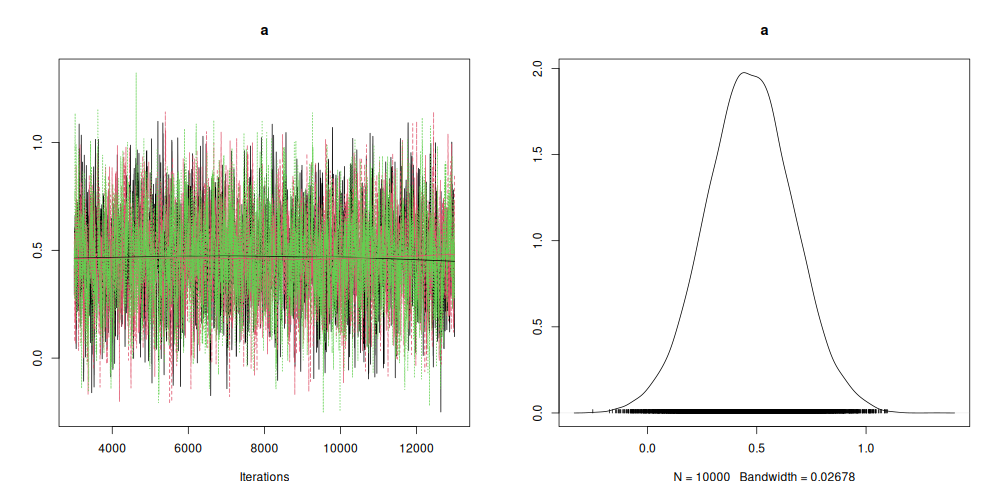 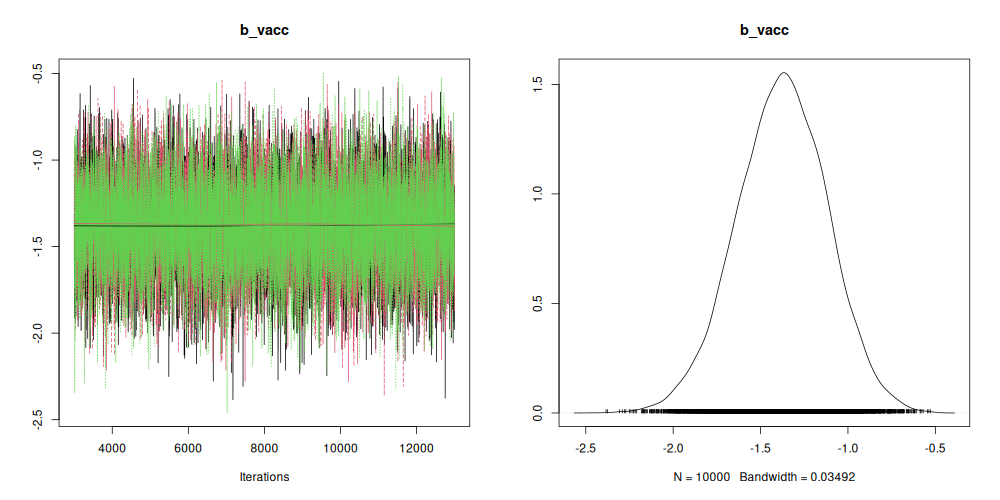
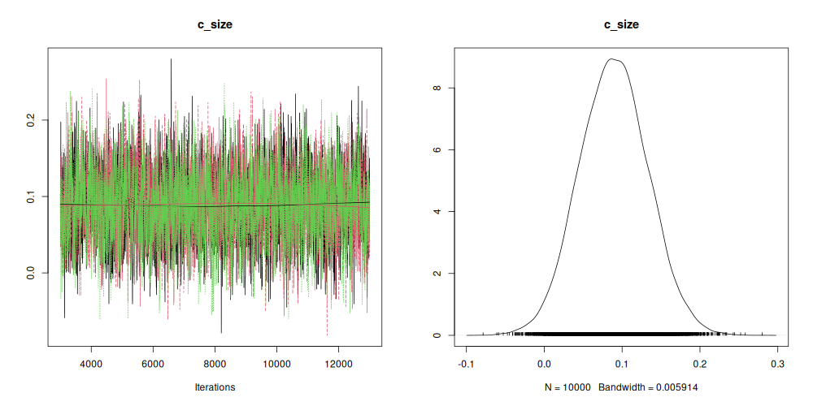 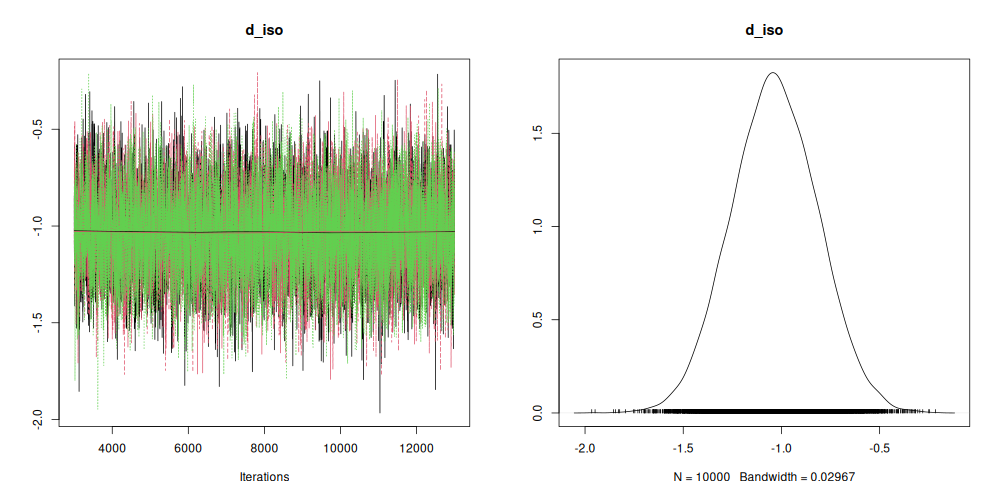
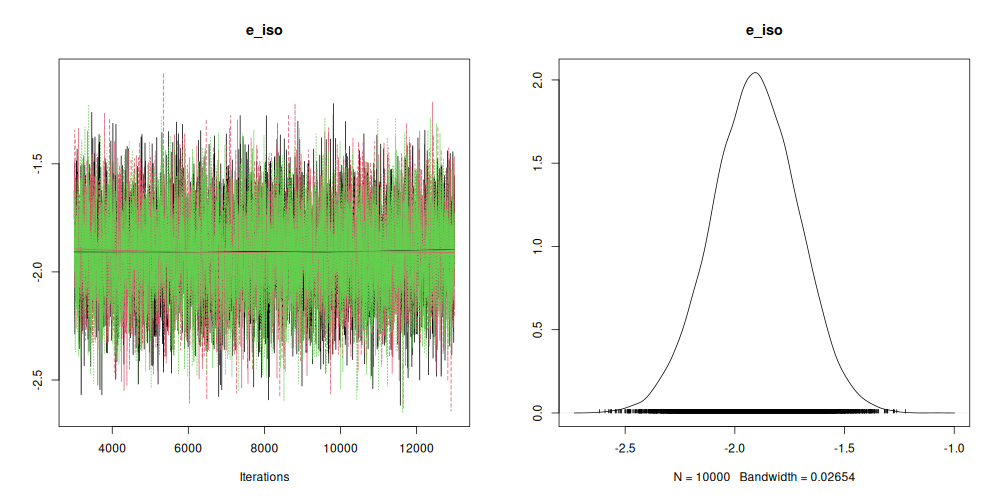

### Gelman-Rubin

Ce diagnostic compare la variabilité entre chaînes à la variabilité à l'intérieur de chaque chaîne. Une valeur proche de 1 indique que les chaînes ont convergé vers la même distribution.

| Coefficient | Facteur de réduction (estimation) | Borne supérieure |
|---|---:|---:|
| a | 1 | 1 |
| b_vacc | 1 | 1 |
| c_size | 1 | 1 |
| d_iso | 1 | 1 |
| e_iso | 1 | 1 |

Le diagnostic multivarié vaut aussi 1. Les graphiques d'évolution montrent un facteur légèrement supérieur à 1 uniquement au tout début des tirages conservés, puis une stabilisation à 1 après quelques milliers d'itérations.

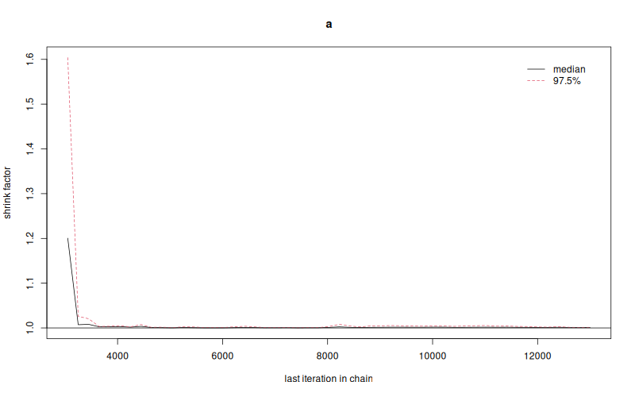  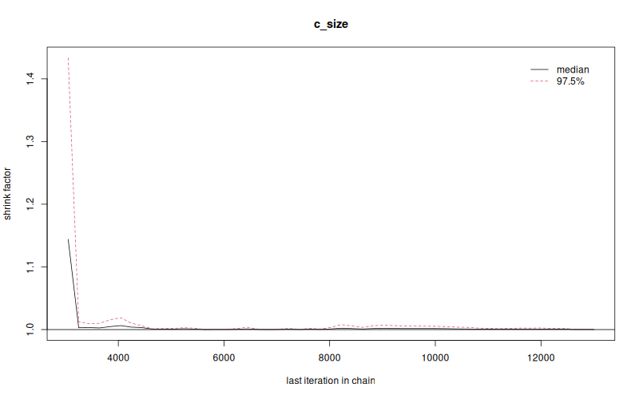
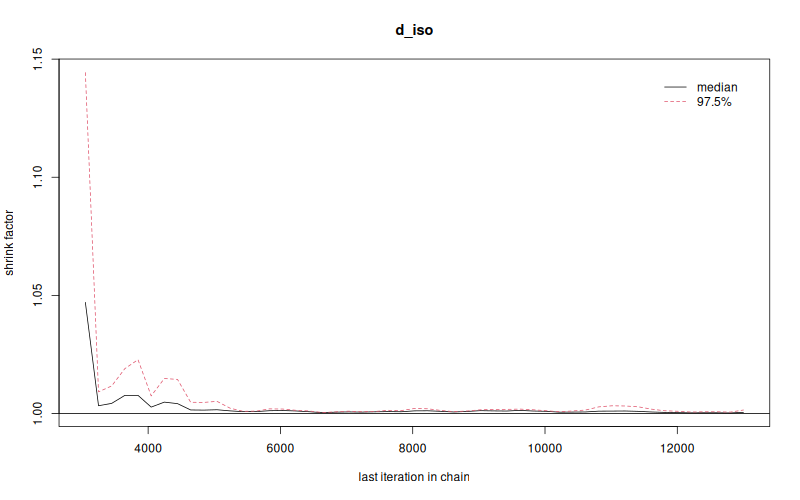 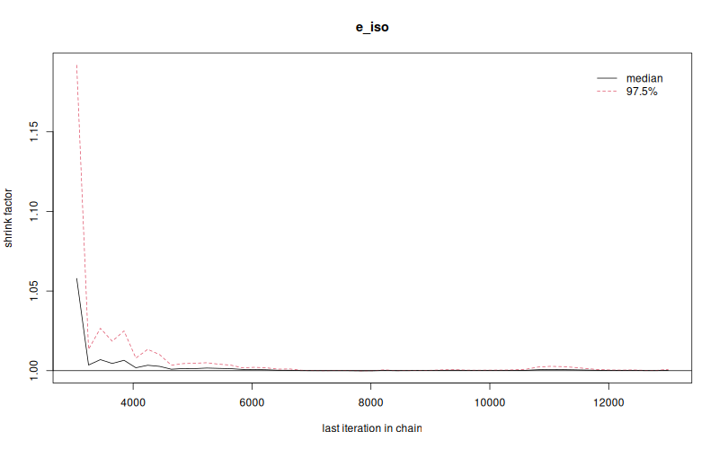

### Autocorrélation et taille d'échantillon effective

Les tirages d'une chaîne MCMC sont corrélés entre eux. La taille d'échantillon effective (ESS) indique combien de tirages indépendants ils valent, sur 30 000 tirages au total.

| Coefficient | ESS | Erreur de Monte Carlo / écart-type a posteriori |
|---|---:|---:|
| a | 2 447 | 2,0 % |
| b_vacc | 13 225 | 0,9 % |
| c_size | 3 053 | 1,8 % |
| d_iso | 7 669 | 1,1 % |
| e_iso | 6 999 | 1,2 % |

- L'autocorrélation décroît vers 0 en une dizaine de décalages pour `d_iso` et `e_iso`, et en une vingtaine pour `c_size`, qui est la plus lente. Cela correspond à son ESS plus faible.
- `a` et `c_size` sont fortement corrélés a posteriori (−0,72). C'est ce qui explique leurs ESS plus faibles. Les autres corrélations sont modérées (entre −0,42 et 0,37 en valeur absolue pour les couples impliquant `a`, `d_iso` et `e_iso`).
- Même pour les paramètres les plus corrélés, l'ESS dépasse 2 400 et l'erreur de Monte Carlo reste de l'ordre de 2 % de l'écart-type a posteriori : elle est négligeable devant l'incertitude statistique.

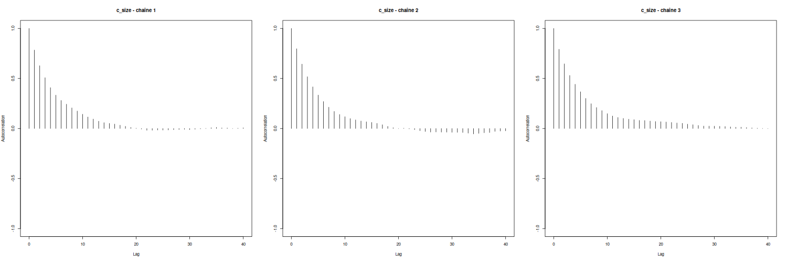
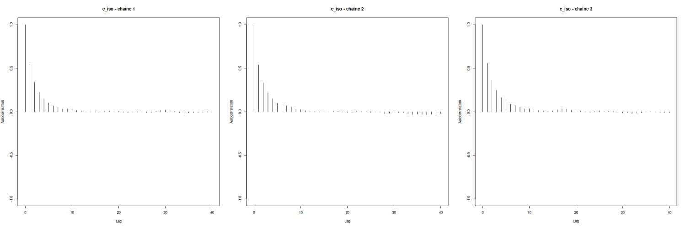

**Conclusion :** les chaînes ont convergé et les tirages sont suffisamment nombreux pour interpréter les résultats. Les graphiques de `a`, `b_vacc` et `d_iso` sont disponibles dans le dossier `figures/`.

## 5. Distributions a posteriori

Les histogrammes a posteriori sont superposés à la distribution de départ de chaque coefficient. Dans tous les cas, la distribution a posteriori est beaucoup plus étroite que la distribution de départ : ce sont les données, et non les hypothèses de départ, qui déterminent les estimations.

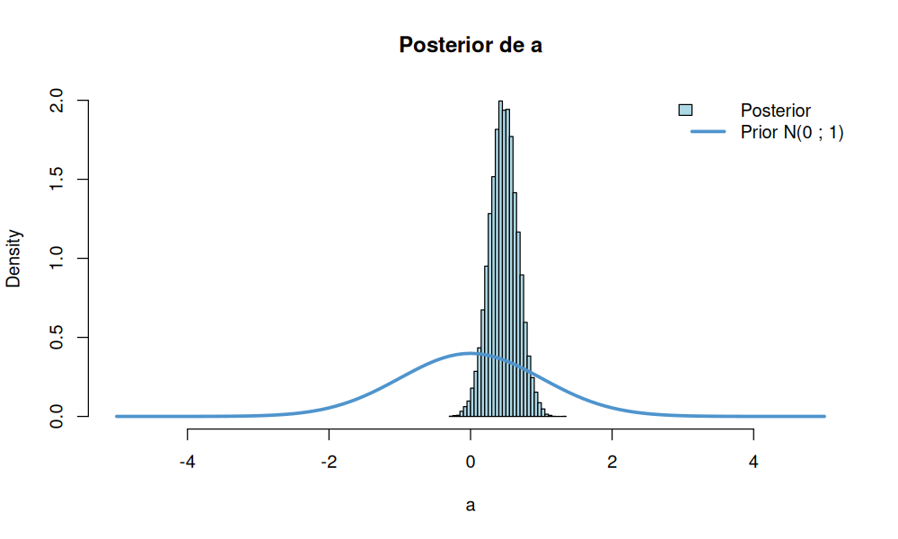 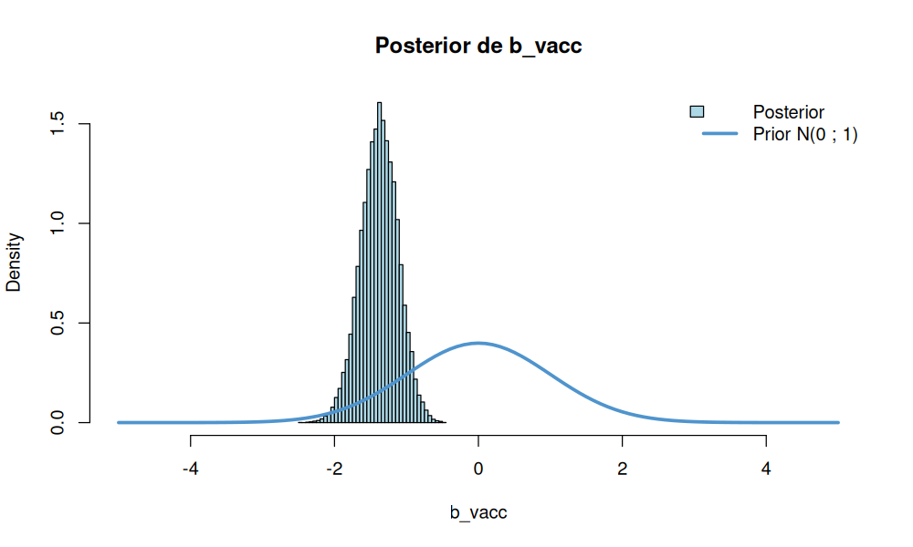
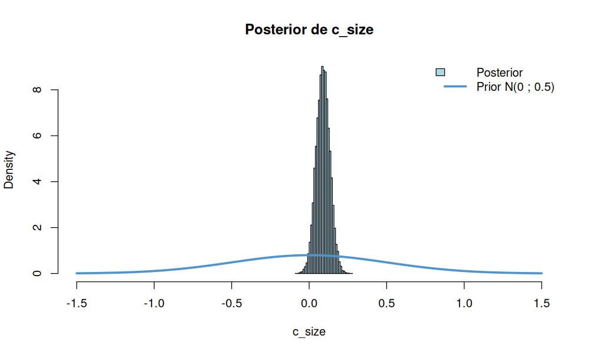 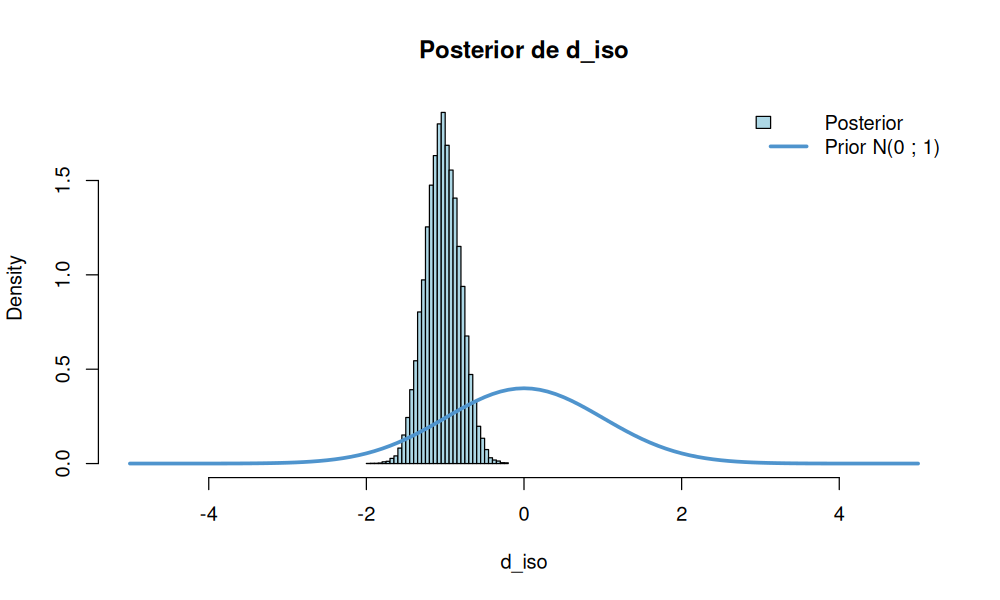
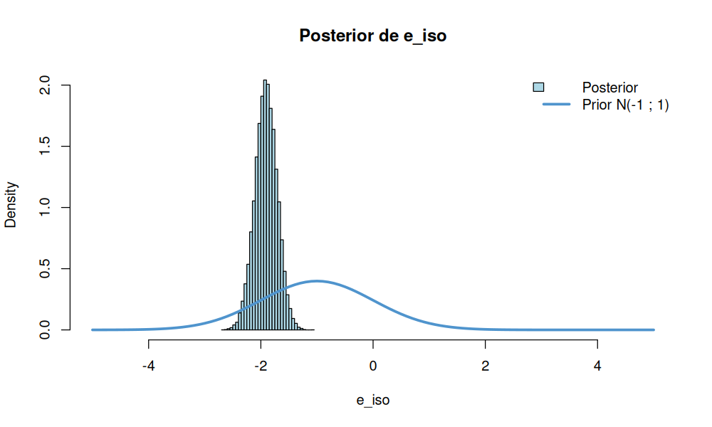

## 6. Estimations des coefficients

### Échelle logit

| Coefficient | Moyenne | Intervalle crédible à 95 % |
|---|---:|---|
| a : constante | 0,467 | [0,072 ; 0,860] |
| b_vacc : vaccination | −1,377 | [−1,899 ; −0,880] |
| c_size : taille du foyer (par personne) | 0,089 | [0,005 ; 0,176] |
| d_iso : isolement partiel | −1,035 | [−1,461 ; −0,603] |
| e_iso : isolement complet | −1,909 | [−2,301 ; −1,527] |

### Odds ratios

L'odds ratio (OR) est l'exponentielle du coefficient. Un OR inférieur à 1 correspond à une baisse des odds d'infection.

| Facteur | OR (médiane) | Intervalle crédible à 95 % | Réduction des odds | P(effet dans le sens attendu) |
|---|---:|---|---:|---:|
| Vaccination | 0,253 | [0,150 ; 0,415] | −75 % | ≈ 1 |
| Isolement partiel | 0,355 | [0,232 ; 0,547] | −65 % | ≈ 1 |
| Isolement complet | 0,148 | [0,100 ; 0,217] | −85 % | ≈ 1 |
| Taille du foyer (+1 personne) | 1,093 | [1,005 ; 1,192] | +9 % | 0,980 |

(P ≈ 1 signifie que tous les tirages conservés vont dans le sens attendu ; cela ne signifie pas une certitude absolue.)

Ces résultats vont dans le même sens que l'article de Layan et al. (réduction du risque par la vaccination et par l'isolement). Les valeurs ne sont pas directement comparables : l'article estime des risques relatifs avec un modèle de transmission, alors que nous estimons des odds ratios avec une régression logistique, et sans distinguer l'âge.

## 7. Isolement complet contre isolement partiel

Nous avons gardé les deux niveaux séparés pour savoir s'ils diffèrent. On compare directement `e_iso` et `d_iso` sur les tirages a posteriori.

| Quantité | Résultat |
|---|---|
| P(e_iso < d_iso) | 0,9999 |
| OR complet vs partiel (médiane) | 0,417 |
| Intervalle crédible à 95 % | [0,264 ; 0,660] |

Par rapport à un isolement partiel, l'isolement complet réduit encore les odds d'infection d'environ **58 %**. L'intervalle exclut 1 : les deux niveaux n'ont pas le même effet, ce qui justifie de ne pas les avoir regroupés comme dans l'article.

## 8. Probabilités d'infection par profil

Les coefficients sont difficiles à lire sur l'échelle logit. On calcule donc, à chaque tirage a posteriori, la probabilité d'infection de différents profils, puis la moyenne et l'intervalle crédible à 95 %.

Profils comparés dans un foyer de **5 personnes**, taille la plus représentée dans les données (179 contacts) :

| Vaccination | Aucun isolement | Isolement partiel | Isolement complet |
|---|---|---|---|
| Non vacciné | 68 % [61 ; 73] | 43 % [34 ; 51] | 24 % [19 ; 29] |
| Vacciné | 35 % [24 ; 46] | 16 % [9 ; 25] | 7 % [4 ; 12] |

Baisse absolue du risque par rapport à l'absence d'isolement :

| Vaccination | Isolement partiel | Isolement complet |
|---|---|---|
| Non vacciné | −25 points [15 ; 35] | −44 points [36 ; 51] |
| Vacciné | −19 points [11 ; 27] | −27 points [19 ; 36] |

- Les deux protections se cumulent : chacune réduit le risque, et leur combinaison donne la probabilité la plus basse.

## 9. Vérification prédictive par foyer

On vérifie si le modèle reproduit les données observées. Pour 2000 tirages a posteriori, on simule les infections des 667 contacts en conservant leurs caractéristiques réelles, puis on compare quatre caractéristiques aux valeurs observées. La proportion bayésienne est la fraction de simulations qui atteignent au moins la valeur observée ; une valeur proche de 0 signifie que l'observé est trop élevé pour le modèle.

| Caractéristique | Observé | Moyenne simulée | Intervalle prédictif à 95 % | Proportion bayésienne |
|---|---:|---:|---|---:|
| Nombre total d'infectés | 269 | 268,7 | [237 ; 300] | 0,50 |
| Foyers sans contact infecté | 97 | 72,8 | [59 ; 87] | 0,0005 |
| Foyers où tous les contacts sont infectés | 43 | 27,2 | [18 ; 37] | 0,0015 |
| Écart-type du nombre d'infectés par foyer | 1,62 | 1,39 | [1,23 ; 1,54] | 0,002 |

- **Le modèle reproduit le nombre total d'infectés.** C'est attendu pour une régression logistique avec une constante.
- **Il ne reproduit pas la répartition entre foyers.** Les trois caractéristiques liées aux foyers dépassent la borne supérieure de l'intervalle prédictif : il y a plus de foyers « tout ou rien » que prévu, et une dispersion plus grande entre foyers.

**Limite mise en évidence.** Le modèle suppose les infections indépendantes une fois la vaccination, la taille du foyer et l'isolement pris en compte. Or des contacts d'un même foyer partagent le même cas index, le même logement et des chaînes de transmission communes : leurs infections sont corrélées. Les intervalles crédibles du modèle sont donc probablement trop étroits, car 667 contacts d'un même foyer valent moins que 667 observations indépendantes. Un effet aléatoire de foyer serait l'amélioration naturelle.

## 10. Critère DIC

| Déviance moyenne | Pénalité (nombre effectif de paramètres) | Déviance pénalisée (DIC) |
|---|---:|---:|
| 757,3 | 4,79 | 762,1 |

La pénalité vaut environ 5, ce qui correspond bien aux 5 coefficients du modèle.
## 11. Conclusion

**Dans quelle mesure la vaccination, la taille du foyer et l'isolement sont-ils associés au risque d'infection des contacts ?**

- **Vaccination :** forte association avec un risque plus faible (OR 0,25 ; IC 95 % [0,15 ; 0,42]).
- **Isolement :** forte association avec un risque plus faible, graduée : partiel (OR 0,36) puis complet (OR 0,15). L'isolement complet fait mieux que le partiel (OR 0,42 ; IC [0,26 ; 0,66]).
- **Taille du foyer :** association positive mais faible (+9 % d'odds par personne ; IC [0,5 % ; 19 %]), la moins nette des trois.
- **Cumul :** dans un foyer de 5 personnes, le risque passe d'environ 68 % (non vacciné, sans isolement) à environ 7 % (vacciné, isolement complet).

**Limites :**

- **Dépendance entre contacts d'un même foyer.** Le modèle ne la représente pas : la vérification prédictive montre qu'elle existe, et les intervalles crédibles sont probablement trop étroits.
- **Pas d'ajustement sur l'âge.** 
- **Contexte.** Les données concernent le variant Alpha et le vaccin BNT162b2 : les résultats ne sont pas forcément transposables à d'autres variants.